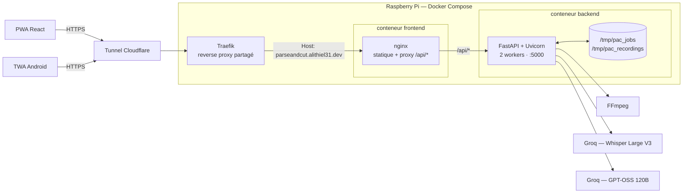
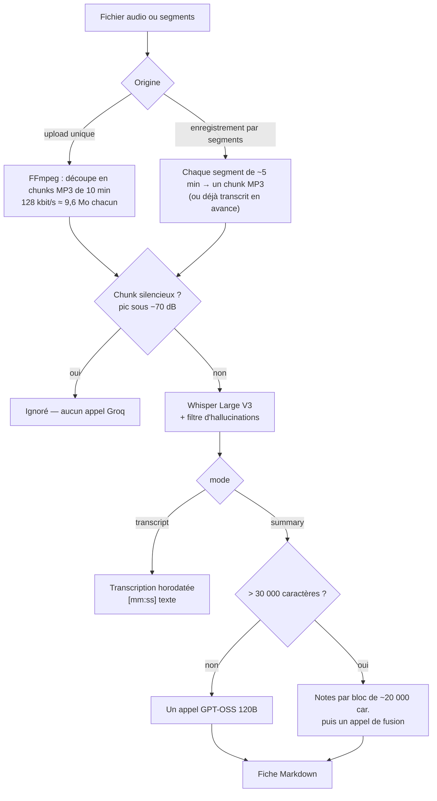
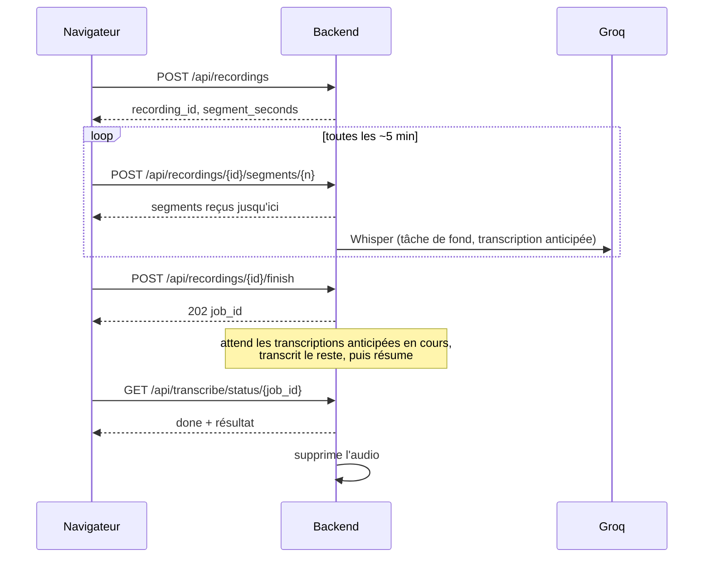

# Architecture

🇬🇧 [English version](./architecture.md)

[Retour au README](../README.fr.md)

Vue d'ensemble du système, du navigateur jusqu'à l'API Groq :



Le navigateur et l'app Android passent par le même tunnel Cloudflare et le même nginx : la TWA
n'est qu'une coquille qui charge le PWA depuis `parseandcut.alithiel31.dev`, elle ne parle jamais
directement au backend. nginx sert les fichiers statiques et route `/api/*` vers FastAPI sur le
réseau Docker interne — en same-origin, donc sans CORS à gérer en production. Le backend est le
seul composant qui appelle Groq, et il ne publie aucun port sur l'hôte.

---

## Un job, pas une requête

Cloudflare coupe toute réponse qui dépasse 100 s (HTTP 524), et cette limite n'est pas réglable
sur les plans Free/Pro/Business. La transcription d'un long enregistrement dure bien plus
longtemps : le traitement est donc **toujours asynchrone**.

1. `POST /api/transcribe/start` stocke l'upload, crée un job et répond `202` avec un `job_id`.
2. Un thread démon exécute le pipeline et écrit sa progression dans le job.
3. Le frontend sonde `GET /api/transcribe/status/{job_id}` et affiche l'étape réelle
   (`cutting` → `whisper` → `llm`, avec les compteurs de chunks et de blocs de résumé).
4. La première lecture d'un statut terminal (`done` ou `error`) **consomme** le job : il est supprimé.

Une erreur est stockée sous la forme `http_status` + un `detail` traduit, puis relevée en
`HTTPException` quand le client la lit. Si une partie de l'audio était déjà transcrite avant
l'échec, la réponse porte aussi `partial_transcript` : le travail n'est pas perdu.

Pourquoi des fichiers et pas Redis : le conteneur tourne avec **2 workers Uvicorn**, et la requête
qui crée un job et celle qui le sonde peuvent tomber sur deux processus différents. Le système de
fichiers du conteneur est le seul état qu'ils partagent, ce qui suffit à l'échelle d'un outil
personnel. Corollaire : **les jobs et les enregistrements ne survivent pas à un redémarrage du
conteneur** (ils vivent dans le `/tmp` du conteneur).

---

## Pipeline de traitement



| Étape                  | Détail                                                                                                                                                                                                  |
| ---------------------- | ------------------------------------------------------------------------------------------------------------------------------------------------------------------------------------------------------- |
| Découpage              | Chunks MP3 de 10 minutes (`CHUNK_DURATION_SEC`) : chaque fichier reste très en dessous de la limite de 25 Mo de Groq. Un chunk est supprimé dès qu'il est transcrit, et dans un `finally` en cas d'échec. |
| Silence                | Un chunk dont le pic est sous −70 dB n'est pas envoyé à Whisper (il hallucinerait et consommerait du quota). Un enregistrement entièrement silencieux échoue avec un `422` explicite.                    |
| Filtre d'hallucinations | Sur du silence, Whisper « complète » avec des textes vus à l'entraînement (« Thanks for watching », « Sous-titrage Société Radio-Canada »…). Les segments sont écartés d'après le signal propre à Whisper (`no_speech_prob`/`avg_logprob`) ou une liste de phrases connues. |
| Réessais               | Tout appel Groq (Whisper et LLM) ne retente que les erreurs transitoires — réseau/timeout, `429`, `5xx` — jusqu'à 5 tentatives, en respectant `retry-after` (plafonné à 120 s), sinon par backoff exponentiel. Une clé invalide ou un fichier refusé échoue tout de suite. |
| Résumé                 | ≤ 30 000 caractères : un seul prompt. Au-delà, notes détaillées par bloc de ~20 000 caractères, puis un prompt de fusion. Les prompts suivent la langue demandée (`fr`/`en`) ; Whisper détecte toujours seul la langue parlée. |
| Mode transcription     | Court-circuite entièrement le LLM et renvoie la transcription horodatée.                                                                                                                                 |

---

## Enregistrement par segments

Enregistrer une réunion de 2 h dans un seul fichier, c'est tout perdre si l'onglet plante.
L'enregistreur du navigateur découpe donc le flux du micro en **segments autonomes** et les envoie
pendant que la réunion se poursuit.



- **Envoi idempotent** — renvoyer un segment le remplace ; le résultat d'une transcription anticipée
  est lié à une signature du fichier et rejeté si le segment a été renvoyé entre-temps.
- **Transcription anticipée** (`RECORDING_EARLY_TRANSCRIPTION`) — chaque segment est transcrit dès
  son arrivée, 2 au plus à la fois par processus. À la fin, il ne reste que le dernier segment et
  le résumé. Toute erreur est avalée : le pipeline final refait simplement ce segment.
- **Segments manquants** — `finish` répond `409` avec la liste `missing` ; le navigateur peut les
  renvoyer depuis sa copie locale puis réessayer.
- **Nettoyage** — l'audio est supprimé à la fin du job, ou au bout de 6 h si l'enregistrement a été
  abandonné. Les fichiers de job jamais relus sont supprimés après 2 h.
- **Plafonds** — `MAX_SEGMENT_SIZE_MB`, `MAX_RECORDING_SIZE_MB`, `MAX_SEGMENTS`.

Côté client, `frontend/src/recordingStore.ts` garde l'enregistrement dans **IndexedDB** (segments
terminés + morceaux d'une seconde du segment en cours) : un plantage ne coûte qu'environ une
seconde. `recovery.ts` propose de reprendre un enregistrement interrompu au chargement suivant
(conservé 24 h), et `pendingJob.ts` retient l'identifiant du job en cours pour reprendre le suivi
après un rechargement. L'enregistreur garde l'écran allumé (Screen Wake Lock) et prévient si le
navigateur coupe le micro. Tout se dégrade en silence si IndexedDB est indisponible (navigation
privée).

---

## Couches de sécurité

- **Same-origin** — nginx proxifie `/api/` vers le backend : en production, les requêtes ne portent
  pas d'en-tête `Origin`. `CORS_ORIGINS` ne compte qu'en développement local (Vite sur `:5173` →
  Uvicorn sur `:5000`).
- **Limitation de débit** — slowapi, par IP cliente : `RATE_LIMIT_PROCESS` sur le démarrage d'un job
  ou d'un enregistrement, `RATE_LIMIT_SEGMENTS` sur l'envoi des segments (compteur partagé via
  `scope`, sinon chaque URL aurait le sien). `ProxyHeadersMiddleware` fait de `request.client.host`
  l'IP réelle du client derrière nginx, Traefik et Cloudflare ; sans lui, tout le monde partagerait
  un seul quota.
- **Validation des envois** — liste blanche d'extensions (415), copie en flux avec plafond de taille
  (413), identifiants vérifiés contre `^[0-9a-f]{32}$` avant de construire le moindre chemin,
  `secure_filename` sur les noms.
- **Durcissement navigateur** — CSP stricte (aucun script, style, police ni CDN externe),
  `X-Frame-Options`, `nosniff`, `Referrer-Policy`, HSTS, et une `Permissions-Policy` qui n'accorde
  que le micro. Le Markdown produit par le LLM est assaini par DOMPurify avant d'atteindre le DOM.
- **Conteneur** — le backend tourne sous un utilisateur non-root (`appuser`).
- **Aucun audio conservé** — voir « Enregistrement par segments » et la page de confidentialité du PWA.

---

## Structure

```
ParseAndCutV2/
├── docker-compose.yml          # backend + frontend (labels Traefik sur le frontend)
├── Dockerfile                  # python:3.10-slim + FFmpeg, non-root, 2 workers Uvicorn
├── deploy.sh                   # injecte GROQ_API_KEY depuis Infisical, puis compose up --build
├── requirements.txt
├── app/
│   ├── main.py                 # app FastAPI, CORS, limiteur, ProxyHeadersMiddleware
│   ├── config.py               # variables d'environnement, client Groq
│   ├── i18n.py                 # catalogue fr/en des messages de l'API
│   ├── limiter.py              # limiteur slowapi partagé
│   ├── models/schemas.py       # modèle de réponse de /health
│   ├── routers/
│   │   ├── transcribe.py       # POST /api/transcribe/start, GET …/status/{job_id}
│   │   ├── recordings.py       # API d'enregistrement par segments
│   │   ├── validation.py       # contrôles lang / mode / fichier audio
│   │   └── health.py           # GET /health
│   └── services/
│       ├── pipeline.py         # orchestration : chunks → Whisper → résumé, tâches de fond
│       ├── audio.py            # FFmpeg : durée, silence, conversion MP3, découpage
│       ├── transcription.py    # appel Whisper + filtre d'hallucinations
│       ├── summary.py          # résumé en une passe ou par blocs
│       ├── prompt.py           # prompts du LLM (fr/en)
│       ├── groq_retry.py       # politique de réessais commune
│       ├── jobs.py             # store de jobs sur fichiers
│       └── recordings.py       # store de segments sur fichiers
├── tests/                      # pytest — Groq et FFmpeg sont simulés
├── scripts/                    # benchmark_transcription.py (ratio durée audio / temps de traitement)
├── docs/                       # cette documentation
└── frontend/
    ├── Dockerfile              # build Vite → nginx
    ├── nginx.conf              # CSP, proxy /api/, assetlinks.json
    ├── vite.config.ts          # vite-plugin-pwa / Workbox
    ├── src/
    │   ├── App.tsx, main.tsx
    │   ├── api.ts              # seul endroit qui appelle le backend
    │   ├── pages/              # Home, pages légales, NotFound
    │   ├── components/         # DropZone, AudioRecorder, ModeSelector, ProgressSteps, ResultView…
    │   ├── hooks/              # useTranscriptionJob, useNotifyPreference
    │   ├── i18n/               # dictionnaires fr / en et provider
    │   ├── content/legal/      # CGU, confidentialité, mentions légales (fr + en)
    │   ├── segmentedRecording.ts, recordingStore.ts, recovery.ts, pendingJob.ts
    │   └── notifications.ts    # « me prévenir à la fin » via le service worker
    └── twa-parseandcut/        # projet Android généré par Bubblewrap
```
