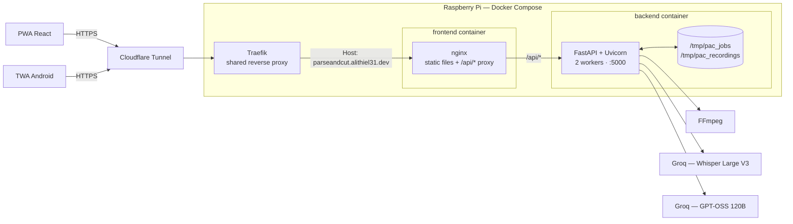
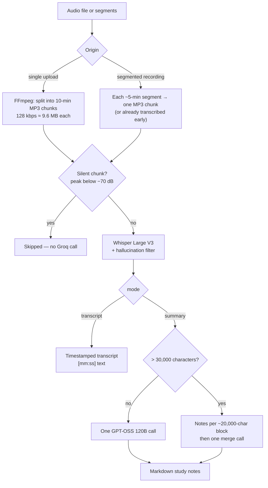
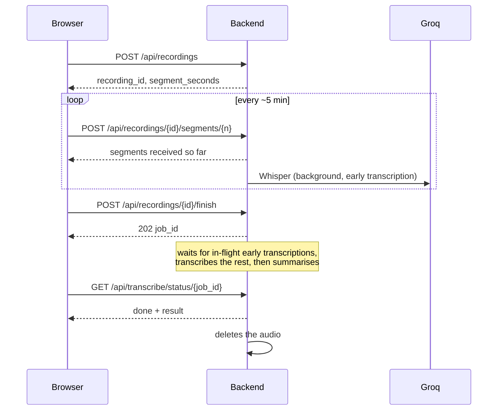

# Architecture

🇫🇷 [Version française](./architecture.fr.md)

[Back to the README](../README.md)

Overview of the system, from the browser to the Groq API:



The browser and the Android app go through the same Cloudflare Tunnel and the same nginx: the
TWA is only a shell that loads the PWA from `parseandcut.alithiel31.dev` and never talks to the
backend directly. nginx serves the static files and proxies `/api/*` to FastAPI on the internal
Docker network — same-origin, so no CORS to manage in production. The backend is the only
component that calls Groq, and it publishes no port on the host.

---

## A job, not a request

Cloudflare cuts any response that takes longer than 100 s (HTTP 524) and that limit cannot be
raised on the Free/Pro/Business plans. A transcription of a long recording takes far longer, so
the processing is **always asynchronous**:

1. `POST /api/transcribe/start` stores the upload, creates a job and answers `202` with a `job_id`.
2. A daemon thread runs the pipeline and writes its progress into the job.
3. The frontend polls `GET /api/transcribe/status/{job_id}` and shows the real step
   (`cutting` → `whisper` → `llm`, with chunk and summary-block counters).
4. The first read of a terminal status (`done` or `error`) **consumes** the job: it is deleted.

An error is stored as `http_status` + a translated `detail` and re-emitted as an `HTTPException`
when the client reads it. When part of the audio was already transcribed before the failure, the
response also carries `partial_transcript`, so the work is not lost.

Why files and not Redis: the container runs **2 Uvicorn workers**, and the request that creates a
job and the one that polls it can land on different processes. The container filesystem is the
only state they share, which is enough for a personal-scale tool. The corollary is that **jobs and
recordings do not survive a container restart** (they live in `/tmp` of the container).

---

## Processing pipeline



| Step                 | Detail                                                                                                                                                                                       |
| -------------------- | -------------------------------------------------------------------------------------------------------------------------------------------------------------------------------------------- |
| Chunking             | 10-minute MP3 chunks (`CHUNK_DURATION_SEC`) keep each file far below Groq's 25 MB limit. Chunks are deleted as soon as they are transcribed, and in a `finally` block on failure.            |
| Silence              | A chunk whose peak is below −70 dB is not sent to Whisper (it would hallucinate and burn quota). A fully silent recording fails with an explicit `422`.                                      |
| Hallucination filter | Whisper "completes" silence with text seen during training ("Thanks for watching", "Sous-titrage Société Radio-Canada"…). Segments are dropped on Whisper's own `no_speech_prob`/`avg_logprob` signal, or on a list of known phrases. |
| Retries              | Every Groq call (Whisper and LLM) retries transient errors only — network/timeout, `429`, `5xx` — up to 5 attempts, honouring `retry-after` (capped at 120 s), otherwise exponential backoff. A bad key or a rejected file fails at once. |
| Summary              | ≤ 30,000 characters: a single prompt. Beyond that, detailed notes per ~20,000-character block, then a merge prompt. The prompts follow the requested language (`fr`/`en`); Whisper always auto-detects the spoken language. |
| Transcript mode      | Skips the LLM entirely and returns the timestamped transcript.                                                                                                                                |

---

## Segmented recording

Recording a 2-hour meeting as a single file means losing everything if the tab crashes. The
in-browser recorder therefore cuts the microphone stream into **self-contained segments** and
uploads them while the meeting is still running.



- **Idempotent upload** — sending the same segment again replaces it; the result of an early
  transcription is tied to a signature of the file and discarded if the segment was resent meanwhile.
- **Early transcription** (`RECORDING_EARLY_TRANSCRIPTION`) — each segment is transcribed as soon
  as it arrives, at most 2 at a time per process. At the end only the last segment and the summary
  remain. Any failure is swallowed: the final pipeline simply redoes that segment.
- **Missing segments** — `finish` answers `409` with the list of `missing` indices; the browser
  can resend them from its local copy and retry.
- **Cleanup** — the audio is deleted when the job ends, or after 6 h if the recording was
  abandoned. Job files left unread are removed after 2 h.
- **Limits** — `MAX_SEGMENT_SIZE_MB`, `MAX_RECORDING_SIZE_MB`, `MAX_SEGMENTS`.

On the client side, `frontend/src/recordingStore.ts` keeps the recording in **IndexedDB**
(finished segments plus one-second chunks of the current one), so a crash loses about a second.
`recovery.ts` offers to resume an interrupted recording at the next load (kept 24 h), and
`pendingJob.ts` remembers the running job id so polling resumes after a page reload. The recorder
holds a Screen Wake Lock and warns if the browser mutes the microphone. Everything degrades
silently if IndexedDB is unavailable (private browsing).

---

## Security layers

- **Same-origin** — nginx proxies `/api/` to the backend, so production traffic carries no `Origin`
  header. `CORS_ORIGINS` only matters for local development (Vite on `:5173` → Uvicorn on `:5000`).
- **Rate limiting** — slowapi, per client IP: `RATE_LIMIT_PROCESS` on starting a job or a recording,
  `RATE_LIMIT_SEGMENTS` on segment uploads (a shared counter via `scope`, otherwise each URL would
  get its own). `ProxyHeadersMiddleware` makes `request.client.host` the real client IP behind
  nginx, Traefik and Cloudflare; without it everybody would share one quota.
- **Upload validation** — extension whitelist (415), streamed copy with a size cap (413), identifiers
  checked against `^[0-9a-f]{32}$` before building any path, `secure_filename` on names.
- **Browser hardening** — strict CSP (no external script, style, font or CDN), `X-Frame-Options`,
  `nosniff`, `Referrer-Policy`, HSTS, and a `Permissions-Policy` that grants only the microphone.
  The Markdown produced by the LLM is sanitised with DOMPurify before it reaches the DOM.
- **Container** — the backend runs as a non-root user (`appuser`).
- **No audio retained** — see "Segmented recording" and the privacy page served by the PWA.

---

## Structure

```
ParseAndCutV2/
├── docker-compose.yml          # backend + frontend (Traefik labels on the frontend)
├── Dockerfile                  # python:3.10-slim + FFmpeg, non-root, 2 Uvicorn workers
├── deploy.sh                   # injects GROQ_API_KEY from Infisical, then compose up --build
├── requirements.txt
├── app/
│   ├── main.py                 # FastAPI app, CORS, rate limiter, ProxyHeadersMiddleware
│   ├── config.py               # environment variables, Groq client
│   ├── i18n.py                 # fr/en catalogue of API messages
│   ├── limiter.py              # shared slowapi limiter
│   ├── models/schemas.py       # /health response model
│   ├── routers/
│   │   ├── transcribe.py       # POST /api/transcribe/start, GET …/status/{job_id}
│   │   ├── recordings.py       # segmented recording API
│   │   ├── validation.py       # lang / mode / audio file checks
│   │   └── health.py           # GET /health
│   └── services/
│       ├── pipeline.py         # orchestration: chunks → Whisper → summary, background tasks
│       ├── audio.py            # FFmpeg: duration, silence, MP3 conversion, chunking
│       ├── transcription.py    # Whisper call + hallucination filter
│       ├── summary.py          # one-pass or block-wise summary
│       ├── prompt.py           # LLM prompts (fr/en)
│       ├── groq_retry.py       # shared retry policy
│       ├── jobs.py             # file-based job store
│       └── recordings.py       # file-based segment store
├── tests/                      # pytest — Groq and FFmpeg are mocked
├── scripts/                    # benchmark_transcription.py (audio-duration / processing-time ratio)
├── docs/                       # this documentation
└── frontend/
    ├── Dockerfile              # Vite build → nginx
    ├── nginx.conf              # CSP, /api/ proxy, assetlinks.json
    ├── vite.config.ts          # vite-plugin-pwa / Workbox
    ├── src/
    │   ├── App.tsx, main.tsx
    │   ├── api.ts              # the only place that calls the backend
    │   ├── pages/              # Home, legal pages, NotFound
    │   ├── components/         # DropZone, AudioRecorder, ModeSelector, ProgressSteps, ResultView…
    │   ├── hooks/              # useTranscriptionJob, useNotifyPreference
    │   ├── i18n/               # fr / en dictionaries and provider
    │   ├── content/legal/      # terms, privacy, legal notice (fr + en)
    │   ├── segmentedRecording.ts, recordingStore.ts, recovery.ts, pendingJob.ts
    │   └── notifications.ts    # "notify me when done" via the service worker
    └── twa-parseandcut/        # Bubblewrap-generated Android project
```
